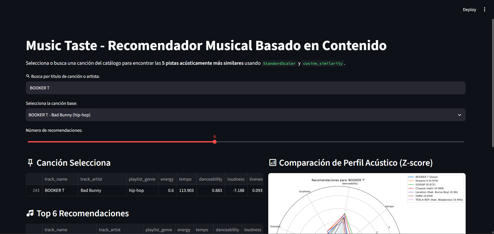

# 🎵 MusicTaste V1 — Content-Based Music Recommendation Engine


**MusicTaste V1** es un sistema de recomendación musical basado en contenido (*Content-Based Filtering*) que analiza la huella acústica de **4,494 canciones únicas** de Spotify. A través de la estandarización vectorial (**Z-score**) y el cálculo de **Similitud Coseno** en un espacio de 9 dimensiones, el motor identifica y visualiza las pistas acústicamente más similares sin depender del historial de otros usuarios ni sesgar los resultados por popularidad comercial.

---

## 🖼️ Demo de la Aplicación

<!-- Guarda tu captura de pantalla en assets/app_demo.png para que se visualice aquí -->


---

## 🧠 Decisiones Técnicas y Pipeline de Datos

### 1. Auditoría de Calidad y Consolidación del Catálogo (`df_clean`)
El catálogo se construye a partir de dos datasets de Spotify (`high_popularity` con 1,686 registros y `low_popularity` con 3,145 registros, sumando 4,831 filas en bruto):
- **Manejo de Nulos (`NaN`):** Se detectó y eliminó **1 registro corrupto** en el conjunto de baja popularidad (`track_id = 2teI76KKFE6qkpLZJs7tZ7`) que carecía de las 18 variables técnicas y acústicas, restaurando la integridad de tipos enteros (`int64`) en columnas como `duration_ms`, `key`, `mode` y `time_signature`.
- **Deduplicación por Clave Primaria (`track_id`):** Se demostró durante el EDA que una misma canción puede aparecer múltiples veces debido a su inclusión en distintas playlists (`playlist_genre`, `playlist_name`), manteniendo intactas sus *audio features*, además de existir 43 canciones compartidas en la frontera de popularidad (`track_popularity == 68`). Se deduplicó por `track_id` (`keep="first"`), consolidando un catálogo limpio de **4,494 canciones únicas**.

### 2. Selección de Características (*Feature Selection*)
Cada canción se modela como un vector $\mathbf{x} \in \mathbb{R}^9$ utilizando exclusivamente variables acústicas continuas:
`energy`, `tempo`, `danceability`, `loudness`, `liveness`, `valence`, `speechiness`, `instrumentalness` y `acousticness`.
- **Exclusión deliberada de `track_popularity` y `playlist_genre`:** Se omitieron del vector de entrenamiento para evitar sesgos de popularidad (permitiendo descubrir joyas ocultas con la misma estructura sonora que un éxito comercial) y evitar el ruido de etiquetas contextuales de playlists (ej. canciones pop o hip-hop clasificadas en listas de *gaming* o *ambient*).

### 3. Escalado Estadístico (`StandardScaler`)
El análisis exploratorio reveló una fuerte disparidad de escalas: mientras 7 características operan en el rango $[0, 1]$, `tempo` oscila entre $48.2$ y $241.4\text{ BPM}$ ($\mu = 118.28, \sigma = 28.71$) y `loudness` opera en decibelios negativos entre $-48.1$ y $1.3\text{ dB}$ ($\mu = -9.49, \sigma = 7.29$).
- Se aplicó estandarización **Z-score** ($z = \frac{x - \mu}{\sigma}$), centrando las 9 dimensiones en $\mu = 0$ y $\sigma = 1$ para garantizar que todas las propiedades acústicas contribuyan equitativamente al cálculo geométrico.

### 4. Motor de Similitud Coseno en Tiempo $O(n)$
Para medir la cercanía acústica entre la canción consultada $\mathbf{u}$ y cualquier pista candidata $\mathbf{v}$, se calcula el coseno del ángulo entre sus vectores estandarizados:

$$\text{Cosine Similarity}(\mathbf{u}, \mathbf{v}) = \frac{\mathbf{u} \cdot \mathbf{v}}{\Vert{}\mathbf{u}\Vert{} \Vert{}\mathbf{v}\Vert{}}$$

En lugar de mantener en memoria la matriz completa $N \times N$ ($4494 \times 4494$), el módulo de producción (`src/recommender.py`) calcula en tiempo real el producto punto únicamente entre el vector consultado ($1 \times 9$) y la matriz del catálogo ($4494 \times 9$), logrando complejidad $O(n)$ en tiempo y memoria.

---

## 📂 Estructura del Proyecto

```text
Music-Taste/
├── app/
│   └── app.py                           # Interfaz web interactiva en Streamlit
├── assets/
│   └── blue_rose.png                    # Íconos y capturas de la aplicación
├── data/
│   ├── high_popularity_spotify_data.csv # Dataset crudo (alta popularidad)
│   ├── low_popularity_spotify_data.csv  # Dataset crudo (baja popularidad)
│   └── spotify_clean.csv                # Catálogo consolidado y limpio (4,494 pistas)
├── notebooks/
│   └── exploration_clean.ipynb          # Auditoría de datos, EDA visual y prototipo
├── src/
│   └── recommender.py                   # Módulo backend (escalado, similitud y Radar Charts)
├── pyproject.toml                       # Definición de dependencias del proyecto
└── uv.lock                              # Lockfile reproducible gestionado con uv